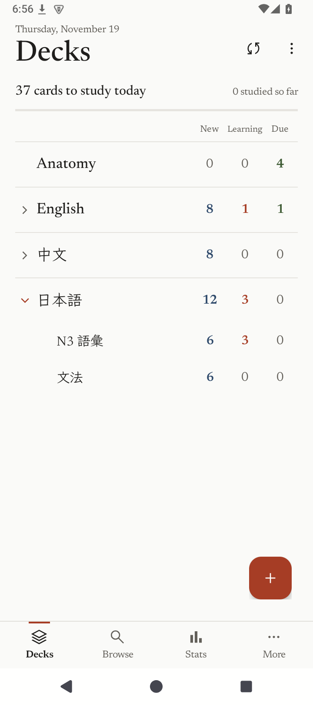
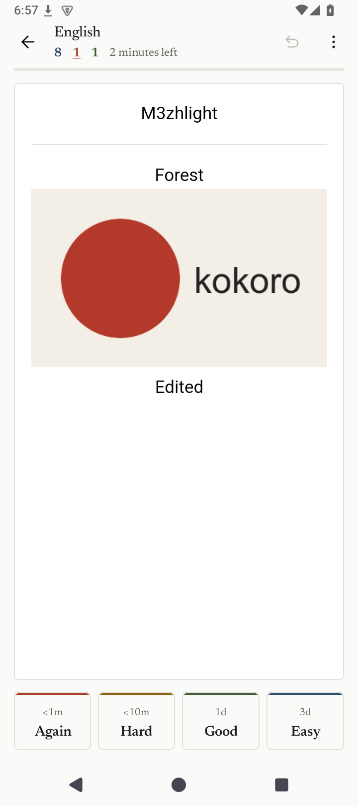
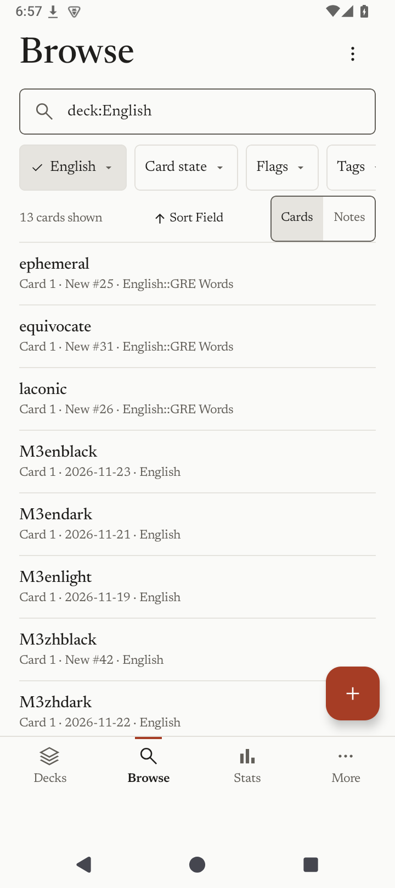

<p align="center">
  
</p>
<h1 align="center">Hayaki</h1>
<p align="center">Spaced-repetition flashcards for Android</p>
<p align="center">
  
  
  <a href="COPYING"></a>
</p>
<p align="center">English · <a href="README.zh-CN.md" lang="zh-CN">简体中文</a></p>

Hayaki brings your Anki collection to Android. Review due cards offline, look up a note mid-session, and edit it on the same device. The interface pairs serif type with light, dark and black themes.

<p align="center">
  
  
  
</p>

## Start studying

1. Open Hayaki and import an Anki deck package (`.apkg`), or start with an empty collection and create your first deck.
2. Open a deck, reveal the answer, and rate your recall. The scheduler uses your rating to plan the next review.
3. Use **Browse** to search cards and edit notes. Open **Statistics** to see your review history and upcoming workload.

A deck package merges into your collection. Restoring a collection package (`.colpkg`) replaces the collection on the device. To sync across devices, connect Hayaki to your own Anki sync server. For a collection currently on AnkiWeb, sync in desktop Anki first, then export a package with media.

## Build and install

Use JDK 21 and the Android SDK with platform 37. Set `ANDROID_HOME` or configure `sdk.dir` in `local.properties`.

```sh
git clone https://github.com/amemiya02/Hayaki.git
cd Hayaki
./gradlew :AnkiDroid:assemblePlayDebug
```

Debug APKs are written to `AnkiDroid/build/outputs/apk/play/debug/`. To install directly on a connected Android 7.0+ device with USB debugging enabled, run `./gradlew :AnkiDroid:installPlayDebug`. Hayaki uses a separate application ID and can be installed alongside AnkiDroid.

## Project and license

Hayaki is independently maintained and builds on [AnkiDroid](https://github.com/ankidroid/Anki-Android) and the [Anki engine](https://github.com/ankitects/anki). The Android app is licensed under GPL-3.0-or-later. Engine components, the public API and bundled assets carry their respective licenses. [License](COPYING) · [License notices](LICENSES/) · [Android walkthrough](docs/redesign/milestone-5/README.md)
