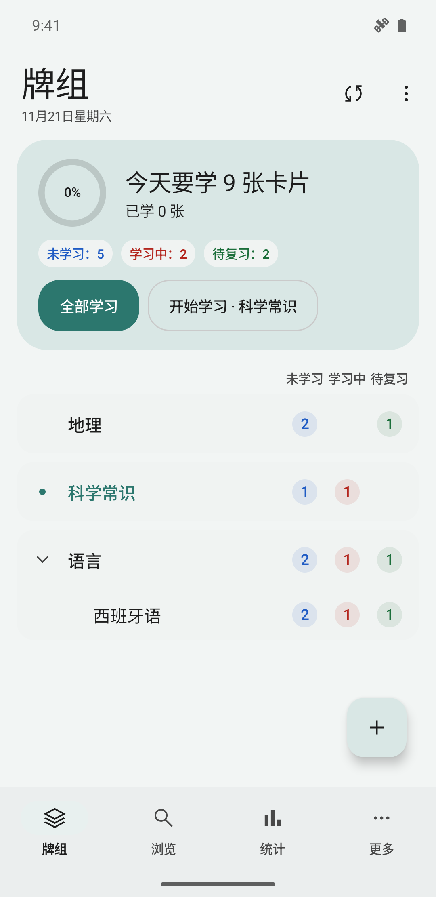
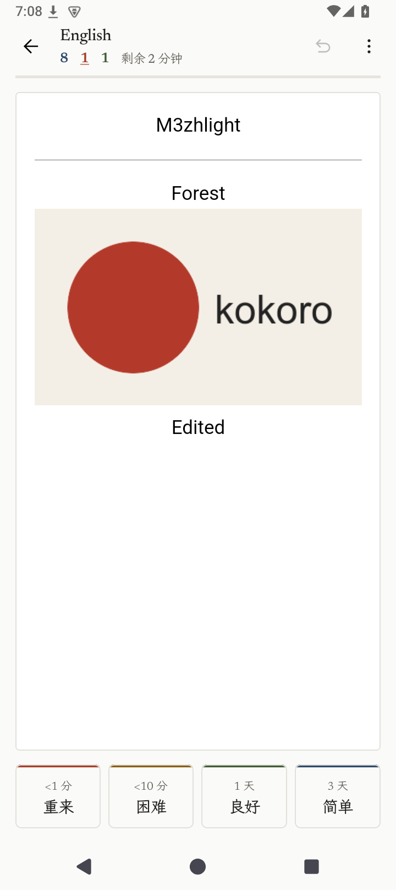
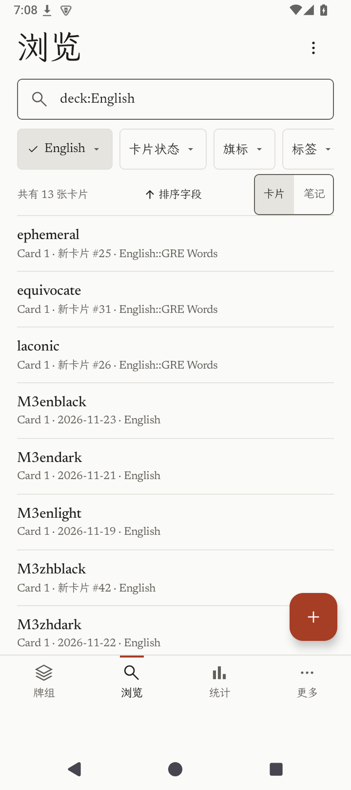

<p align="center">
  
</p>
<h1 align="center">Hayaki</h1>
<p align="center">Android 上的间隔重复记忆卡片应用</p>
<p align="center">
  
  
  <a href="COPYING"></a>
</p>
<p align="center"><a href="README.md" lang="en">English</a> · 简体中文</p>

用 Hayaki 在 Android 上学习已有的 Anki 牌组。你可以离线复习到期卡片，在学习途中查找和编辑笔记。界面使用衬线字体，提供浅色、深色和纯黑三种主题。

<p align="center">
  
  
  
</p>

## 开始学习

1. 打开 Hayaki，导入 Anki 牌组包（`.apkg`），也可以从空集合开始，创建第一个牌组。
2. 进入牌组，回忆答案后翻开卡片，再按记忆程度评分。调度器会据此安排下次复习。
3. 在「浏览」中搜索卡片、编辑笔记，在「统计」中查看复习记录和未来的学习量。

导入牌组包会把内容合并到当前集合。恢复集合包（`.colpkg`）会替换本机集合。要跨设备同步，点「同步」并登录 AnkiWeb，或选择自托管并输入自己的 Anki 同步服务器地址。

## 构建与安装

准备 JDK 21 和 Android SDK（平台 37），设置 `ANDROID_HOME`，或在 `local.properties` 中配置 `sdk.dir`。

```sh
git clone https://github.com/amemiya02/Hayaki.git
cd Hayaki
./gradlew :AnkiDroid:assemblePlayDebug
```

调试版 APK 位于 `AnkiDroid/build/outputs/apk/play/debug/`。连接已启用 USB 调试的 Android 7.0 或更高版本设备后，也可以运行 `./gradlew :AnkiDroid:installPlayDebug` 直接安装。Hayaki 使用独立的应用 ID，可以与 AnkiDroid 同时安装。

## 项目与许可

Hayaki 独立维护，基于 [AnkiDroid](https://github.com/ankidroid/Anki-Android) 和 [Anki 引擎](https://github.com/ankitects/anki) 开发。Android 应用采用 GPL-3.0-or-later 许可。引擎组件、公共 API 和内置资源分别遵循各自的许可证。[许可证](COPYING) · [许可声明](LICENSES/) · [Android 界面实录](docs/redesign/milestone-5/README.md)
